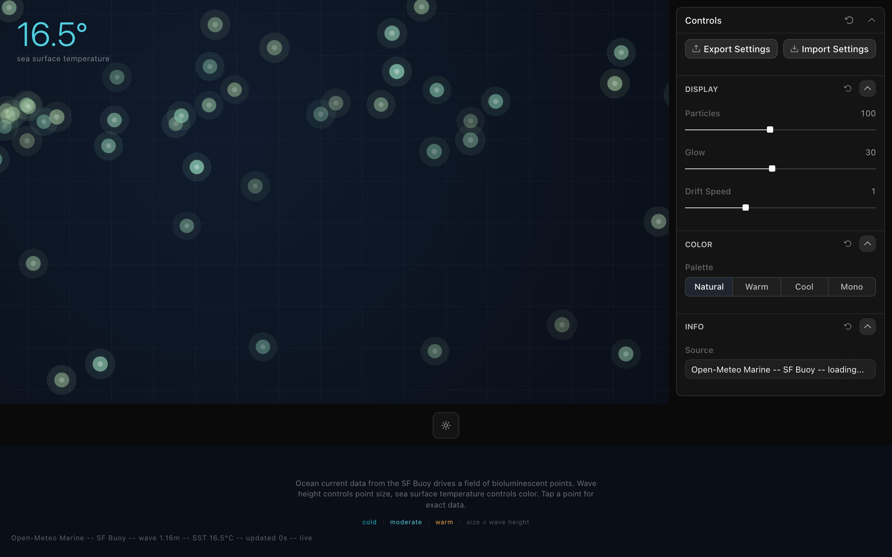

<div align="center">

<h1>Lume</h1>

<p><b>Glowing points drift on the current off San Francisco.</b></p>

<p><i>The Bay's marine forecast, drawn as a slow field of bioluminescence: colour from the water temperature, size from the waves, drift from the current.</i></p>

<h6>


</h6>

<a href="https://lume-6mm.pages.dev"><b>Live demo</b></a> ·
<a href="#how-it-works"><b>How it works</b></a> ·
<a href="#run-it"><b>Run it</b></a>

<br><br>

<a href="https://lume-6mm.pages.dev"></a>

<sub>Live capture, 22 October 2026. Real forecast data, not a demo.</sub>

</div>

<br>

About a hundred and twenty glowing points pulse and drift across a dark ocean grid. All of them
are driven by one reading: the current hour of the
[Open-Meteo Marine](https://open-meteo.com/en/docs/marine-weather-api) forecast for the grid
point at 37.77° N, 122.42° W. Warmer water shifts the field from cyan toward amber, bigger waves
make every point larger, and the ocean current sets the direction and speed of the drift. No API
key is needed.

## How it works

| Forecast field (`current`) | Drives |
|---|---|
| `sea_surface_temperature` | Point colour on a 5 to 30 °C scale (cyan, teal, amber, orange), with ±0.75 °C jitter per point, and the big number top-left |
| `wave_height` | Point radius: 6 px plus 4 px per metre |
| `ocean_current_velocity` | Drift speed |
| `ocean_current_direction` | Drift heading, with a little random spread per point |

The page refetches every 60 seconds and the points take on each new reading. If the request
fails it uses fixed fallback values (1.06 m waves, 15.4 °C) and the footer stamp says `fallback`
instead of `live`. Click a point to open a card with the current wave height, temperature, current
speed and heading; it fades after three seconds.

The side panel sets the number of points (20 to 200), glow radius, drift speed and the palette
(Natural, Warm, Cool, Mono), and its Source field shows the latest reading.

## Run it

```bash
git clone https://github.com/parthchandak02/lume.git
cd lume
npm install
npm run dev      # dev server on a free port
npm run build    # typecheck, then static site in dist/
```

The build is a static `dist/` folder, deployed to Cloudflare Pages.

<details>
<summary><b>Project layout</b></summary>

```
src/components/LumeCanvas.tsx  Point field, glow rendering, drift and click hit-testing
src/data/marine.ts             Open-Meteo Marine fetch, fallback, colour ramps, heading names
src/routes/index.tsx           Page chrome: temperature readout, legend, stamp, data card
src/app/app-schema.ts          The Toolcraft controls panel
src/toolcraft/                 Toolcraft runtime and UI components
brief.md                       The original creative brief
```

</details>

<details>
<summary><b>Known rough edges</b></summary>

- `lume.parthchandak.info` does not resolve yet; the Pages URL above is the working one.

</details>

<br>

<div align="center">
<sub>Built with React, Canvas 2D, Vite and Toolcraft. Data from Open-Meteo Marine.</sub>
</div>
