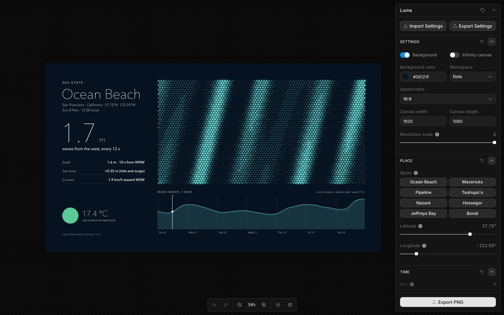

<div align="center">

<h1>Lume</h1>

<p><b>The sea state at any surf spot, as a field of light.</b></p>

<p><i>Waves and swell from the marine forecast, drawn as glowing points where the two wave trains cross, with seven days of waves beside them.</i></p>

<h6>


</h6>

<a href="https://lume-6mm.pages.dev"><b>Live app</b></a> ·
<a href="#how-it-works"><b>How it works</b></a> ·
<a href="#run-it"><b>Run it</b></a>

<br><br>

<a href="https://lume-6mm.pages.dev"></a>

<sub>The default poster: Ocean Beach, today at noon.</sub>

</div>

<br>

Lume draws the sea at one place and moment as a poster. The field of light is a plan view of about
900 m of sea: each point brightens where the wind waves and the swell add up and dims where they
cancel, so the direction and period of the two trains set the pattern and their heights set the
contrast. The left column gives the wave height, where the waves come from and how often, the
swell, the sea level (tide and surge), the current, and the sea surface temperature as a coloured
disc. Below the field, seven days of wave height show what is coming.

Pick one of eight surf spots (Ocean Beach, Mavericks, Pipeline, Teahupoʻo, Nazaré, Hossegor,
Jeffreys Bay, Bondi) or drag Latitude and Longitude anywhere at sea. Step through the forecast with
Day and Hour, and set the glow colour and point spacing. The background can be changed (light
colours flip the ink) or left out, and the poster exports as PNG or JPG at 2K, 4K or 8K.

## How it works

Sea state comes from the free [Open-Meteo Marine API](https://open-meteo.com/en/docs/marine-weather-api):
seven days of hourly wave, swell, sea level, current and sea temperature, fetched once per place and
cached. Each wave train is modelled as a plane wave with the deep-water wavelength 1.56 T² metres,
travelling away from the direction it comes from. Points on land have no marine data, and the
poster then says so and shows a sample sea; the same sample appears, labelled, if the API cannot be
reached.

The poster is drawn with Canvas 2D in a Web Worker at the exact zoomed backing resolution, and the
same drawing function renders the exported image. The editor shell, panel, settings import/export,
saved workspace and image export come from [Toolcraft](https://github.com/pixel-point/toolcraft)
(Pixel Point, MIT).

## Run it

```bash
git clone https://github.com/parthchandak02/lume.git
cd lume
npm install
npm run dev              # local editor; needs Node 22+
npm test                 # unit tests plus Toolcraft's contract checks
npm run verify:delivery  # full functional acceptance in a real browser
```

The live version is a static build (`npm run build`, then `dist/`) on Cloudflare Pages.

<details>
<summary><b>Project layout</b></summary>

```
src/lume/marine-data.ts      Marine request, parsing, cache, land and offline samples
src/lume/lume-draw.ts        Wave interference, chart and the whole poster
src/lume/LumeCanvas.tsx      The live canvas: worker raster at the exact backing size
src/lume/lume-controls.ts    Place, Time and Glow controls; spot shortcuts
src/app/app-schema.ts        Toolcraft schema: sections, canvas, image export
src/app/app-acceptance-data.ts What every control must visibly do (checked in a real browser)
e2e/product-lume-*.spec.ts   Browser acceptance tests, one file per area (API stubbed)
src/toolcraft/               Vendored Toolcraft runtime (do not edit)
```

</details>

<br>

<div align="center">
<sub>Built with Toolcraft, React and Canvas 2D. Sea state from Open-Meteo Marine.</sub>
</div>
